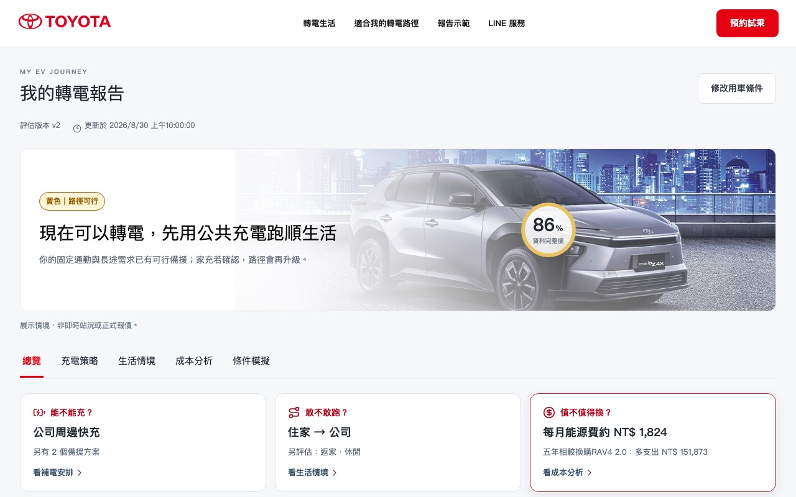

# AIgnite — TOYOTA 電到你

**下一台車，會讓你心動嗎？** 從生活習慣到充電需求，找到最適合你的電動生活。

2026 和泰 AI 黑客松提案原型。車主回答四個生活問題，系統評估**能不能充、敢不敢跑、值不值得換**，產生帶燈號的轉電報告，並同步到 LINE 摘要與業務顧問後台。



本儲存庫僅收錄互動原型，供賽事評審參考。**功能介紹、展示路徑、啟動方式與完成度請見 [`prototype/README.md`](prototype/README.md)。**

## 三分鐘看畫面

需 Node.js 20.19+ 與 pnpm，不需後端或任何金鑰：

```sh
cd prototype
pnpm install --frozen-lockfile
pnpm dev
```

開啟 <http://127.0.0.1:4173/line> 從 LINE 邀請開始走一遍。要體驗實際計算、分享給顧問等完整互動，改用 `pnpm dev:full`（另需 Python 3.9+）。

## 內容

- `prototype/`：前端（React + Vite），含車主網站、LINE 模擬與顧問後台。
- `prototype/services/decision-api/`：後端（FastAPI + SQLite），規則評估、報告版本與分享權限。
- `prototype/docs/`：規格、操作手冊與驗收紀錄，見 [文件索引](prototype/docs/README.md)。

## 展示範圍與資料

- 預設使用內建規則與展示資料，不需任何金鑰。真實 TDX 充電站與 Gemini 為選用設定，本儲存庫不含任何憑證。
- 規則門檻、車款參數與能源價格為工程假設，不代表正式汽車規格、費率或已驗證成果。
- TOYOTA 圖片取自 TOYOTA 台灣官網，版權屬原權利人，僅用於競賽展示；來源紀錄見 [`prototype/docs/toyota-image-sources.md`](prototype/docs/toyota-image-sources.md)。
