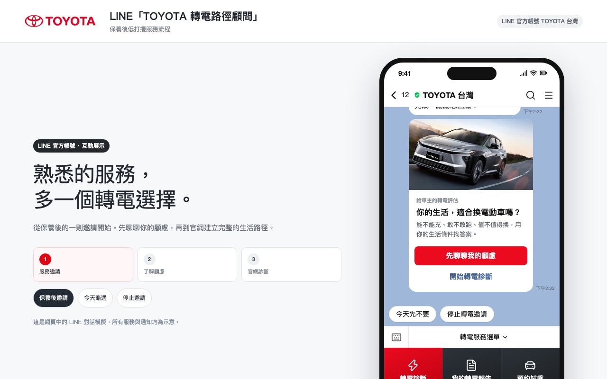
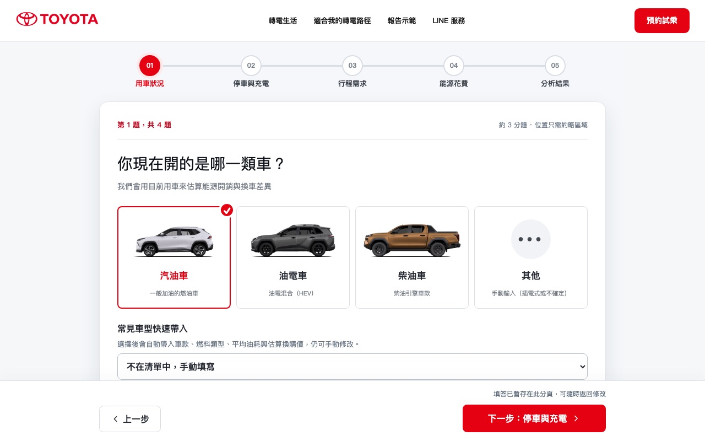
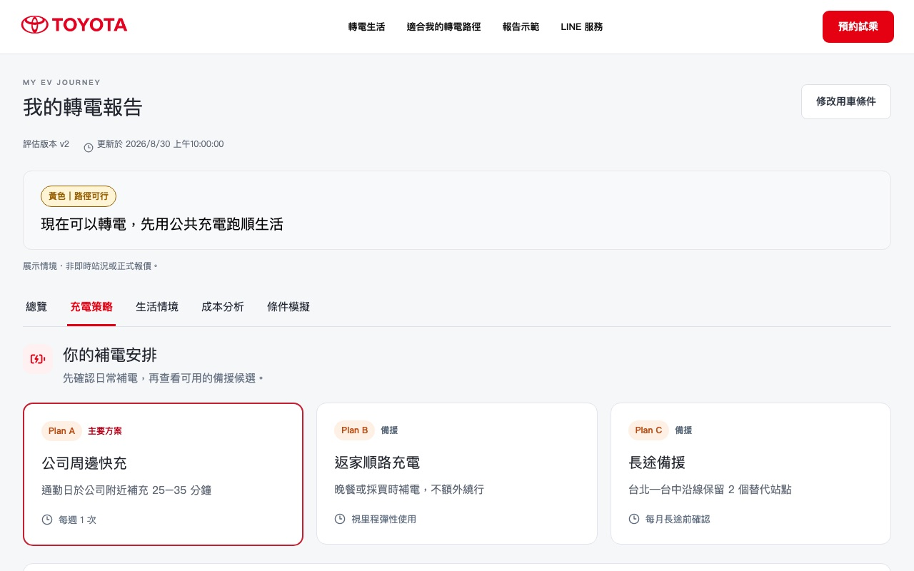
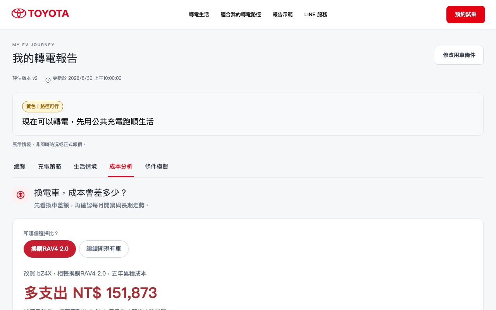
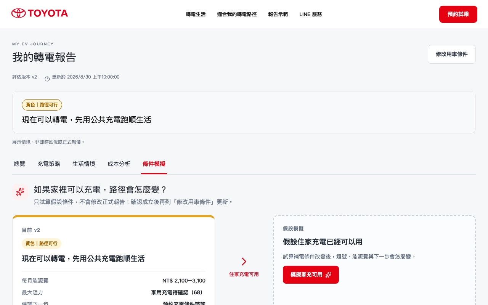
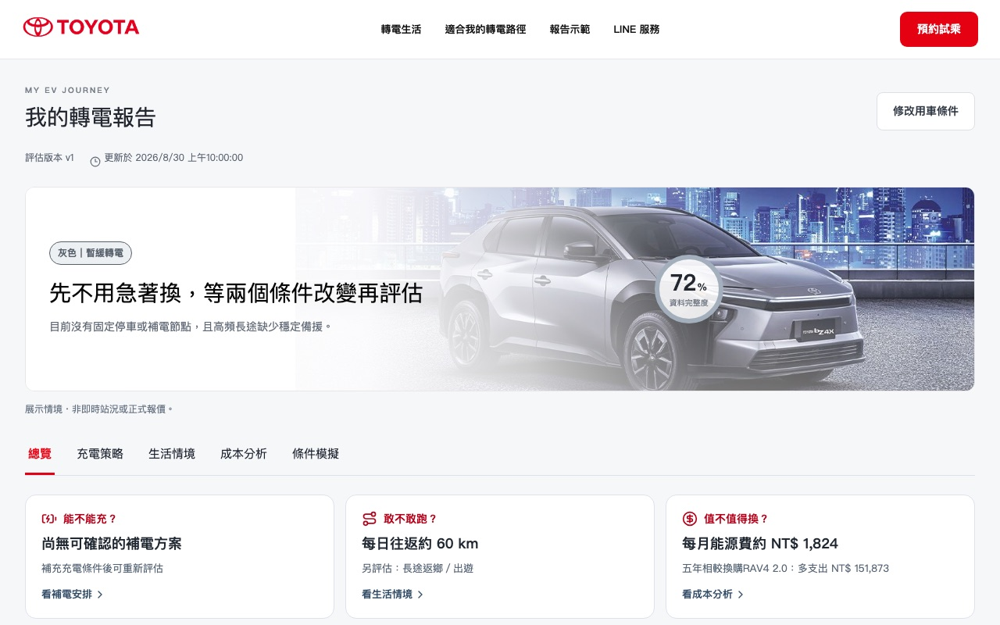
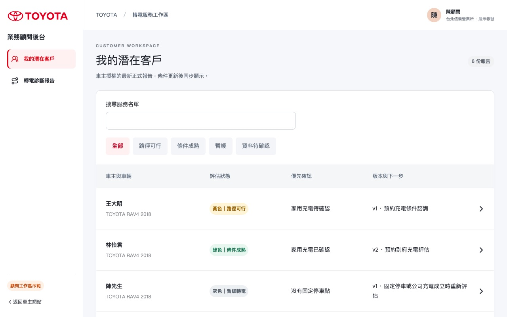
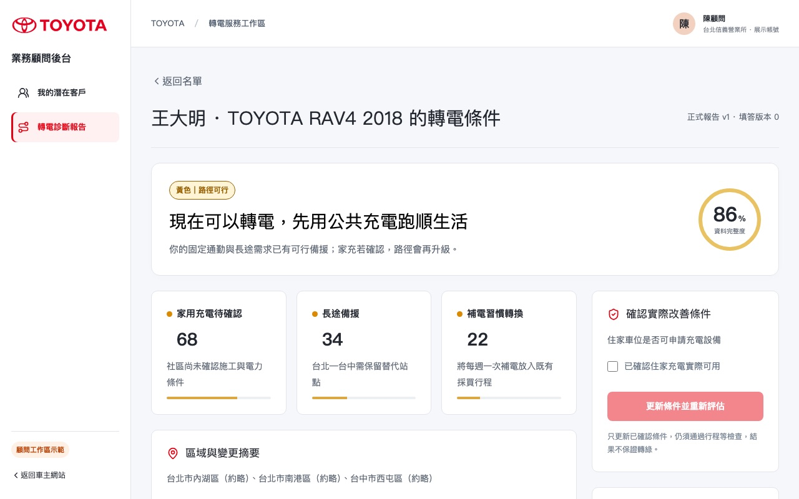
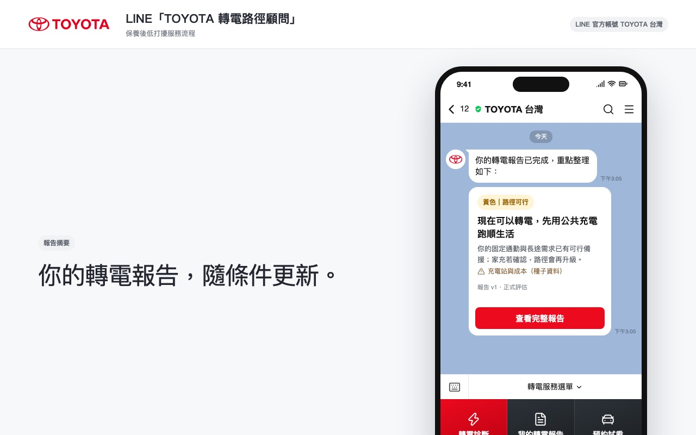
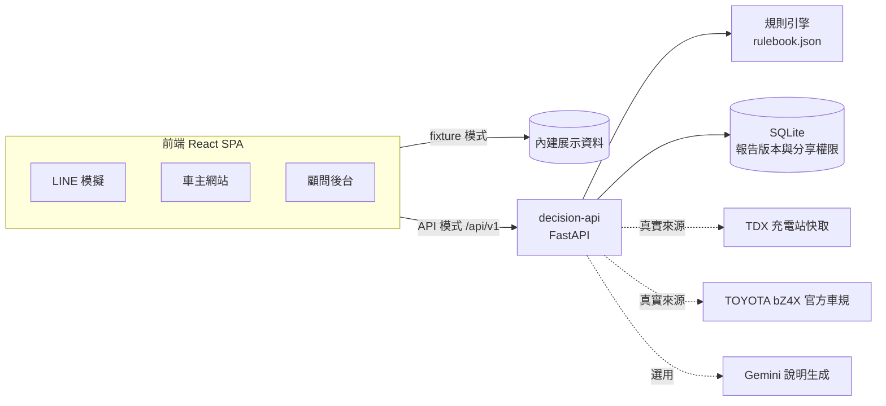

# AIgnite EV Path — TOYOTA 轉電路徑顧問

把「想不想買電動車」轉成「我的生活怎麼轉電」。車主回答四個生活問題，系統評估**能不能充、敢不敢跑、值不值得換**，產生帶燈號的轉電報告；同一份報告同步到 LINE 摘要與業務顧問後台，讓顧問接手時已知道卡在哪個條件。


## 目錄

- [功能一覽](#功能一覽)
- [展示路徑](#展示路徑)
- [快速啟動](#快速啟動)
- [系統架構](#系統架構)
- [完成度與限制](#完成度與限制)
- [驗證結果](#驗證結果)
- [專案結構](#專案結構)
- [疑難排解](#疑難排解)

## 功能一覽

| 入口 | 功能 |
| --- | --- |
| **LINE 服務（網頁模擬）** | 保養後的轉電邀請，可「今天略過」或「停止邀請」；報告完成後推送摘要卡，點擊回到完整報告 |
| **車主網站** | 四步短問卷：目前車種、充電地點、日常距離與長途頻率、能源花費；可略過、保存草稿、事後修改 |
| | 轉電報告：綠／黃／灰／待確認燈號與資料完整度，五個分頁 — 總覽、充電策略（Plan A/B/C）、生活情境、成本分析（對比換購燃油車／續開現有車的五年與十年成本）、條件模擬 |
| | 條件模擬（what-if）另存為模擬版本，不覆蓋正式報告；每次條件更新保留版本歷史 |
| | 預約充電條件諮詢、同意分享給顧問、撤銷分享 |
| **業務顧問後台** | 潛在客戶名單；只看得到車主同意分享的報告；查看阻力分數與待確認條件、留內部筆記、確認改善條件後重新評估產生新版本，車主與 LINE 同步更新 |

燈號由**規則引擎**依充電、行程、成本條件判定；AI 只負責整理說明文字，不決定燈號、不改寫金額。

## 展示路徑

| | |
| --- | --- |
|  **1. LINE 邀請** `/line` |  **2. 四步問卷** `/driver/diagnostic` |
|  **3. 充電策略 Plan A/B/C** |  **4. 成本分析** |
|  **5. 條件模擬** `?tab=whatif` |  **6. 灰燈：建議暫緩** `/driver/report/report-gray` |
|  **7. 顧問名單** `/advisor` |  **8. 顧問接手** `/advisor/reports/report-main` |
|  **9. LINE 報告摘要** `/line/result/family-report-main` | |

Fixture 模式的固定報告可直接開啟：

| 網址 | 情境 |
| --- | --- |
| `/driver/report/report-main` | 黃燈：先用公共充電，家充確認後升級 |
| `/driver/report/report-main-v2` | 綠燈：家充成立，條件成熟 |
| `/driver/report/report-gray` | 灰燈：缺固定補電點與長途備援，建議暫緩 |
| `/driver/report/report-install` | 黃燈：裝樁後可轉 |
| `/driver/report/report-pending` | 待確認：資料不足，引導補充條件 |

開發模式右下角有「Demo 控制」可切換燈號與重設；網址加 `?present=1` 會隱藏這個選單，適合正式展示。

## 快速啟動

需求：Node.js 20.19+ 與 pnpm；API 模式另需 Python 3.9+。

### 1. 只看畫面（fixture 模式，不需後端）

```sh
cd prototype
pnpm install --frozen-lockfile
pnpm dev
```

開啟 <http://127.0.0.1:4173/line> 從 LINE 邀請開始，或直接開上方的固定報告網址。所有資料為內建展示情境，不連任何外部服務。

### 2. 完整互動（API 模式）

```sh
pnpm dev:full
```

第一次執行會自動建立 `services/decision-api/.venv` 並安裝套件，接著同時啟動後端（127.0.0.1:8000）與前端（127.0.0.1:4174）；Ctrl+C 一起停止。開啟 <http://127.0.0.1:4174/driver> 填答，報告由後端實際計算並存進 SQLite。

顧問視角：在**另一個瀏覽器或無痕視窗**開 <http://127.0.0.1:4174/advisor>，按「登入本機展示顧問」；車主在報告頁按「同意分享給示範顧問」後，顧問才看得到該報告。完整操作腳本見 [docs/phase-2-runbook.md](docs/phase-2-runbook.md)。

也可以分開啟動：`pnpm setup:api`（只需一次）→ `pnpm dev:backend` → 另一個終端機 `pnpm dev:api`。

### 3. 資料來源模式

| 模式 | 設定 | 資料 |
| --- | --- | --- |
| 內建規則（預設） | 不需 `.env` | 工程種子車規、站點與費率；可完整操作所有流程 |
| 真實來源 | `services/decision-api/.env` 設 `DECISION_SOURCE_MODE=tdx_cache` 並填 TDX 憑證 | TDX 充電站快取 + TOYOTA 官方 bZ4X 車規；需先刷新快取 |
| AI 說明生成 | 再設 `GENERATION_MODE=llm` 與 Gemini 金鑰（限 Free tier） | 規則結果不變，由 Gemini 整理說明文字；任何失敗自動回到模板 |

真實來源與 Gemini 的設定步驟見 [docs/phase-3-runbook.md](docs/phase-3-runbook.md)。本儲存庫不含任何憑證。

## 系統架構



- **三端同一份報告**：車主、LINE、顧問讀取同一個報告版本的不同投影；只有顧問看得到內部筆記與建議問句，三端都不顯示精確位置。
- **報告不可變**：條件更新或模擬都產生新版本，舊版本可依原規則與原資料快照重算。
- **來源誠實**：資料過期、部分覆蓋或缺資料時，報告標示「待確認」，不以種子資料冒充真實來源。

## 完成度與限制

| 狀態 | 項目 |
| --- | --- |
| 已實作並驗證 | 四步問卷、規則評估與燈號、五分頁報告、成本試算、條件模擬、版本歷史、分享／撤銷、顧問重新評估與筆記、三端同步 |
| 已實作（展示範圍） | TDX 充電站真實快取（台北內湖試點）、TOYOTA bZ4X 官方車規、Gemini Free tier 說明生成 |
| 網頁模擬 | LINE 對話與推播、預約流程、顧問登入 |
| 尚未實作 | 真實 LINE webhook 與身分綁定、企業登入、CRM、主動通知、正式部署 |

規則門檻、可用續航（300 km）、耗能（18 kWh/100km）與能源價格為工程假設，不是官方續航保證或報價；長途只查目的地候選站，未做路線規劃。詳見 [docs/rulebook-review.md](docs/rulebook-review.md) 與 [docs/phase-3-progress.md](docs/phase-3-progress.md)。

## 驗證結果

2026-10-05 於本機重新執行：

| 檢查 | 結果 |
| --- | --- |
| 後端 pytest（規則、來源狀態、權限、版本、模型降級等） | 83 passed |
| 前端單元與資料契約（Vitest） | 15 passed |
| Fixture E2E（Playwright，桌面 1280 + 手機 390） | 36 passed |
| TypeScript、ESLint、production build | 通過 |

真實 TDX 與 Gemini 的整合驗收紀錄見 [docs/phase-3-progress.md](docs/phase-3-progress.md)。

自行執行：

```sh
pnpm typecheck && pnpm lint && pnpm test && pnpm build
pnpm test:api                               # 後端，需先 pnpm setup:api
pnpm exec playwright install chromium       # 第一次跑 E2E 前
pnpm test:e2e                               # fixture 畫面，桌面＋手機
```

API 模式的 E2E：先啟動 8000 後端，執行 `EV_API_TEST_URL=http://127.0.0.1:8000/api/v1 pnpm test` 驗證前後端契約；再啟動 4174 API 前端，執行 `pnpm test:e2e:api`（重啟案例會暫用 8001 與獨立暫存 DB）。

## 專案結構

```
prototype/
├── src/
│   ├── App.tsx                 # 路由與三端畫面
│   ├── components/             # 報告、問卷、LINE 與顧問元件
│   ├── domain/                 # 資料契約（Zod）與車款預設值
│   ├── services/               # fixture／API 兩種資料來源，共用同一介面
│   └── fixtures/               # fixture 模式的展示報告
├── services/decision-api/      # 後端（FastAPI + SQLite），見其 README
├── tests/e2e/                  # Playwright 情境測試
├── scripts/dev-full.sh         # 一鍵啟動後端＋API 前端
└── docs/                       # 規格、操作手冊與驗收紀錄，見 docs/README.md
```

後端說明：[services/decision-api/README.md](services/decision-api/README.md)；文件索引：[docs/README.md](docs/README.md)。

## 疑難排解

**`pnpm dev:full` 顯示 port 已被使用**：先停掉佔用 8000 或 4174 的舊服務。

**報告一直顯示「正在整理」**：fixture（4173）與 API（4174）兩種模式的報告連結不能交叉使用。API 模式請從 <http://127.0.0.1:4174/driver> 開始填答，並確認 <http://127.0.0.1:4174/api/v1/health> 回傳 `ok: true`。報告連結綁定建立它的瀏覽器 cookie，換瀏覽器或清除 cookie 後無法讀取舊連結。單次請求 35 秒無回應時頁面會顯示逾時與「重試」。

**真實來源模式顯示來源失敗**：充電站快取需先依 [docs/phase-3-runbook.md](docs/phase-3-runbook.md) 刷新；超過 24 小時的站點不會列為已確認備援。更新來源不會改寫舊報告，需重新提交條件產生新版。

**切換 fixture／API 模式沒生效**：模式在 Vite 啟動時決定，切換後需重啟前端。前端 `/api` 代理到 `127.0.0.1:8000`。

TOYOTA 圖片取自官網，版權屬原權利人，僅供競賽展示，來源見 [docs/toyota-image-sources.md](docs/toyota-image-sources.md)。
